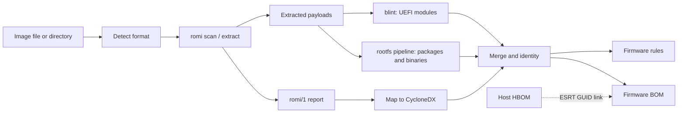

# Firmware SBOM in cdxgen

| | |
| --- | --- |
| Epic | https://github.com/cdxgen/cdxgen/issues/4620 |
| Owner | @prabhu |
| AI use | Pair |
| Corpus | See [cdxgen-firmware-corpus.md](cdxgen-firmware-corpus.md) |

## Why

cdxgen can describe source projects, containers, live hosts and hardware, but not the firmware that runs before any of them. When CVE-2026-97631 was published ([GHSA-99cj-7hg9-mp4m](https://github.com/tianocore/edk2/security/advisories/GHSA-99cj-7hg9-mp4m), a pre-boot overflow in the EDK II PXE driver `NetworkPkg/UefiPxeBcDxe`), we tried to answer "which of our firmware images contain this driver?" with the tools we have:

- `cdxgen -t os` on a hypervisor host listed the `qemu-efi-aarch64` package and its version, but nothing inside the firmware image it installs.
- `cdxgen -t hbom` on an AMI-based host listed the BIOS vendor, version string and date, and a separate fwupd device with the ESRT GUID.
- blint, given `QEMU_EFI.fd`, reported no components.
- A 60-line Python script found and extracted the driver in a few seconds, by decompressing the LZMA firmware volume and searching for the module's GUID.

The gap is not difficulty, but the absence of a careful, safe implementation inside an SBOM generator. Meanwhile the firmware world has moved towards SBOMs. The LVFS builds composite SBOMs from embedded CoSWID and uSWID data. The Open Source Firmware Foundation publishes a draft [Firmware Embedded SBOM specification](https://sbomspec.osfw.foundation/). CISA's HBOM framework treats firmware as part of the hardware picture. The EU Cyber Resilience Act will require SBOMs for products with digital elements, most of which are embedded devices.

This plan is the first of five for cdxgen 13.8.0 that, together with four plans for a new Rust helper called romi, give cdxgen first-class firmware SBOM generation. This one sets up the shared foundation: the project type, the BOM model, the romi bridge, cdxi views and the documentation.

## Scope

In scope:

- a `firmware` project type (aliases `uefi`, `bios`, `rom`, `fw`) for files and directories
- content-based detection of firmware formats, and firmware found inside OS, rootfs and container scans with `--deep`
- the CycloneDX model for firmware: containment, component types, identity, `cdx:firmware:` properties, evidence and completeness reporting
- running romi, validating its report and mapping it to components
- cdxi commands and the firmware guide

Out of scope for this plan, and covered by the companion plans:

- UEFI-specific components, embedded SBOM import, blint deep analysis and HBOM linking ([cdxgen-firmware-uefi.md](cdxgen-firmware-uefi.md))
- embedded Linux filesystems, opkg, binary identification and Linux firmware blobs ([cdxgen-firmware-embedded-linux.md](cdxgen-firmware-embedded-linux.md))
- audit rules, Secure Boot keys, vulnerability identifiers and LVFS metadata ([cdxgen-firmware-audit.md](cdxgen-firmware-audit.md))
- the corpus, golden tests and benchmarks ([cdxgen-firmware-corpus.md](cdxgen-firmware-corpus.md))
- the parsers themselves, which live in romi ([romi-foundation.md](romi-foundation.md), [romi-uefi-formats.md](romi-uefi-formats.md), [romi-firmware-identity.md](romi-firmware-identity.md), [romi-embedded-linux.md](romi-embedded-linux.md))

Live host firmware inventory stays with cdx-hbom ([cdx-hbom-firmware-exposure.md](cdx-hbom-firmware-exposure.md)). Reading flash from hardware stays with the user's own tools (`flashrom`, `fwupdmgr`, vendor utilities). cdxgen never touches hardware.

## Approach

### Architecture

Parsing hostile binary formats happens only in romi, which is written in Rust with `#![forbid(unsafe_code)]`, hard limits and continuous fuzzing. cdxgen never parses firmware structures in JavaScript beyond a small sniffer for format detection when romi is missing. Everything after parsing happens in cdxgen, where the existing machinery already lives: identity, evidence, merging, rules, spec-version compatibility, signing and export.

### The BOM model

The model is decided in cdxgen/cdxgen#4622 and written down in `docs/FIRMWARE.md` before the emitters are built. The proposal:

- **Containment as nesting.** The image is `metadata.component` with type `firmware`. Regions, volumes, files, partitions, filesystems and modules are nested `components`. The dependency graph is reserved for real dependencies, such as UEFI dependency expressions or shared libraries.
- **Types.** `firmware` for images, regions, volumes and vendor blobs. `device-driver` for PEIMs and DXE, SMM and MM drivers. `application` for UEFI applications. `operating-system` for kernels. `data` for variable stores. `cryptographic-asset` for certificates. At spec versions without `device-driver` (before 1.5) or `cryptographic-asset` (before 1.6), the spec-version compatibility stage maps them down and keeps the intended type in a property.
- **Identity.** Deterministic `bom-ref` values built from the image's SHA-256 and the node path. Package URLs only where a real package identity exists: `pkg:github/tianocore/edk2@<tag>#<Package>/<Module>` for EDK II modules of a known release, `pkg:swid/...` for imported CoSWID tags, and the existing distribution purls for embedded Linux packages. A component without reliable identity has no purl.
- **Properties.** `cdx:firmware:kind`, `format`, `path`, `offset`, `size`, `compression`, `guid`, `fileType`, `esrtGuid`, `esrtVersion`, `edk2:release`, `edk2:package`, `debugPath`, `sbomSource`, `signature:*` and `diagnostic`.
- **Evidence.** Identity evidence names the technique and the value. Occurrences carry the node path as location and the byte offset. At spec 2.0 the same facts become attributed claims, building on cdxgen/cdxgen#4591.
- **Completeness.** Unsupported or skipped content is recorded on the affected component and summarised in `metadata.properties`, and the fidelity report gains a firmware coverage tier.

### The romi bridge

romi follows the pattern of golem, rusi and kosi: cdxgen finds the binary through `ROMI_CMD` or the plugins directory, runs it as a child process inside the safer-exec sandbox where available, passes explicit limits, validates the `romi/1` JSON against its published schema, and maps it. The major version is pinned as cdxrs's is. Without romi, cdxgen emits the image with hashes and detected format, marks the BOM as incomplete and says why.

### Where firmware shows up outside `-t firmware`

With `--deep`, OS, rootfs and container scans look for firmware files installed by packages (OVMF, AAVMF, `qemu-efi`, iPXE ROMs, files under `/lib/firmware`) and nest a firmware BOM under the owning package. This is how a hypervisor host's OBOM would answer the CVE-2026-97631 question for the guest firmware it ships.

## Test cases

| Case | Input | Expected |
| --- | --- | --- |
| Format detection | every corpus format, plus ELF, PE, ZIP and random files | correct format, with no false positives |
| Directory scan | directory with OVMF, a coreboot ROM and an OpenWrt image | one BOM, three nested image components |
| Deep OS scan | rootfs fixture with an OVMF package installed | firmware BOM nested under the package |
| Model validation | Ubuntu `QEMU_EFI.fd` BOM | valid at spec 1.5, 1.6, 1.7 and 2.0, with types mapped down where needed |
| Determinism | same image scanned twice | identical BOM apart from serial number and timestamp |
| romi missing | `ROMI_CMD` set to a missing path | image component with hashes, an incompleteness note, and exit code 0 |
| Bad report | romi output that fails schema validation | named error, no partial BOM |
| cdxi | firmware BOM fixtures | snapshot output for `.firmware`, `.firmwaremodules`, `.firmwaresboms` and `.firmwarekeys` |

## Deliverables

### D1. Firmware project type and input detection (cdxgen/cdxgen#4621)

`-t firmware` and its aliases accept files and directories, detect formats by content, unpack vendor update archives safely, and are reachable from `--deep` OS and container scans.

### D2. Firmware BOM model and `cdx:firmware:` properties (cdxgen/cdxgen#4622)

The model above, agreed and documented in `docs/FIRMWARE.md` and `docs/CUSTOM_PROPERTIES.md`, with a validated example BOM.

### D3. romi bridge (cdxgen/cdxgen#4623)

cdxgen runs romi under limits and the sandbox, validates and maps its report, records it in `metadata.tools`, and degrades clearly without it.

### D4. cdxi views (cdxgen/cdxgen#4624)

`.firmware`, `.firmwaremodules`, `.firmwaresboms` and `.firmwarekeys`.

### D5. Documentation (cdxgen/cdxgen#4625)

A firmware guide with a worked CVE-2026-97631 example, and updated agent skills.

## Risks and open questions

- **romi timing.** cdxgen 13.8.0 needs a cdxgen-plugins-bin release with romi. If romi slips, 13.8.0 can still ship the project type, the model and the fallback, but the result would be thin. The romi foundation epic should be scheduled first.
- **Model churn.** Choices like `device-driver` versus `firmware` for modules are hard to change once Dependency-Track users rely on them. The model issue should get review from people who consume firmware SBOMs, for example LVFS and fwupd maintainers and OEM PSIRTs, before the emitters are merged.
- **Size.** A server firmware image can contain several hundred modules, and an embedded image tens of thousands of files. BOM size and cdxi performance need watching, and options to collapse levels (for example `--firmware-depth modules`) may be needed.
- **Sandboxing on macOS and Windows.** safer-exec is strongest on Linux. On other platforms romi's own limits are the main protection, which the threat model must state.

## Outcome

To be filled in when the work ends.
