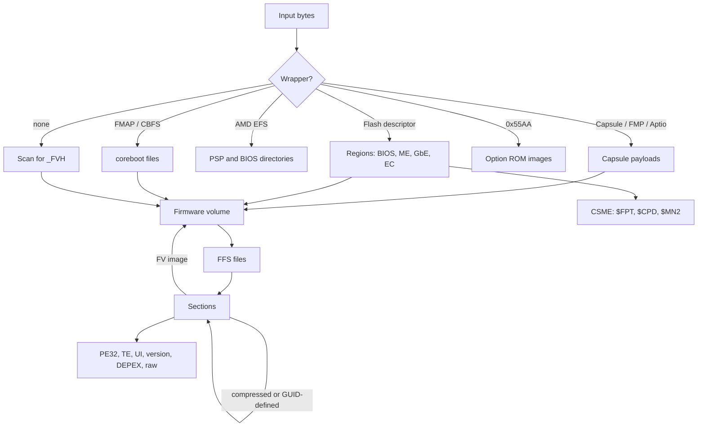

# UEFI and PC firmware formats in romi

| | |
| --- | --- |
| Epic | https://github.com/cdxgen/cdxgen-plugins-bin/issues/144 |
| Owner | @prabhu |
| AI use | Pair |
| Corpus | See [cdxgen-firmware-corpus.md](cdxgen-firmware-corpus.md) |

## Why

PC and server firmware is a stack of formats. A vendor update is a capsule, which holds firmware volumes. A SPI dump starts with an Intel flash descriptor or an AMD embedded firmware structure that divides it into regions, and the BIOS region holds volumes. Volumes hold FFS files, files hold sections, and sections may be compressed or may hold further volumes. Alongside all of this sit silicon vendor blobs (microcode, CSME, FSP, PSP, AGESA), option ROMs, and the variable store that holds the Secure Boot keys. A firmware SBOM is only as complete as the deepest layer the parser reaches.

## Scope

This plan covers the formats in [UEFI Platform Initialization specification](https://uefi.org/specifications) volume 3, the UEFI specification's capsule and variable formats, the common vendor wrappers and blobs, coreboot's CBFS, and option ROMs. Identity and embedded SBOMs are in [romi-firmware-identity.md](romi-firmware-identity.md).

## Approach

### Walk order

### Formats and signatures

| Format | How it is found | What is reported |
| --- | --- | --- |
| Firmware volume | `_FVH` at header offset 40, plus checksum and length checks | GUID, attributes, block map, size |
| FFS file (FFS2 and FFS3, large files) | inside volumes | GUID, type, attributes, state |
| Sections | inside files | type; for leaves: PE32, TE, PIC, UI, version, DEPEX |
| EFI and Tiano compression | compression section | decoded through `mu_uefi_decompress` |
| LZMA | GUID-defined `EE4E5898-3914-4259-9D6E-DC7BD79403CF` | decoded |
| LZMA with x86 filter | GUID-defined `D42AE6BD-1352-4BFB-909A-CA72A6EAE889` | decoded |
| Brotli | EDK II's GUID-defined Brotli section | decoded |
| UEFI and FMP capsules | capsule GUIDs and headers | flags, payload items, image type GUID, version |
| AMI Aptio capsule | vendor header before the UEFI capsule | wrapper type |
| Intel flash descriptor | `0x0FF0A55A` | regions and offsets |
| AMD embedded firmware structure | `0x55AA55AA` at known offsets | PSP (`$PSP`, `2PSP`) and BIOS (`$BHD`) directories |
| Intel CSME | `$FPT`, `$CPD`, `$MN2` | version, partitions |
| Intel FSP | `FSPH` information header | image ID, revision, FSP-T, FSP-M and FSP-S |
| AGESA | `AGESA!` version string | package and version |
| Intel and AMD microcode | 48-byte Intel header; AMD container | signature, revision, date |
| coreboot | `__FMAP__`, `ORBC`, `LARCHIVE` | files, types, compression, build info |
| PCI option ROM | `0x55AA`, `PCIR`, EFI `0x0EF1` | vendor and device IDs, code type, EFI subsystem |
| Variable store | `FFF12B8D-7696-4C8B-A985-2747075B4F50`, auth variable headers, AMI NVAR | variables; Secure Boot certificates and hashes |

Unknown GUID-defined sections, wrappers and vendor formats are reported with their size and hash and a `*-unsupported` diagnostic. They are never silently dropped.

### Reuse and agreement with blint

romi evaluates patina_ffs for the volume walker before writing its own (see the foundation plan's risks). blint plans a lightweight Python unpacker for standalone use ([owasp-dep-scan/blint#265](https://github.com/owasp-dep-scan/blint/issues/265)). Both are tested on the same corpus, and their module lists must agree.

## Test cases

| Case | Input | Expected |
| --- | --- | --- |
| PXE driver | Ubuntu `QEMU_EFI.fd` (`d2d1228a…cab43`) | `UefiPxeBcDxe` (`B95E9FDA-…5E3A`), DXE driver with PE32, from the volume compressed at `0x2a150` |
| Completeness | OVMF and ArmVirtQemu from pinned tags, all architectures | module set equals `Guid.xref` |
| Every encoding | test volume with EFI, Tiano, LZMA, LZMA-x86 and Brotli sections | all decoded |
| Nested volumes | volume inside a section inside a volume, three levels | all walked, and depth reported |
| Capsule | `GenerateCapsule` output around OVMF, signed and unsigned | capsule metadata and the inner volume walked |
| Flash image | synthetic descriptor with OVMF in the BIOS region | regions reported and BIOS walked |
| Option ROM | iPXE `efi-e1000.rom` (`2e100b3f…56d76`) | PCI IDs and the EFI driver |
| coreboot | QEMU build, with an EDK II payload | matches `cbfstool print`, payload walked |
| Microcode | `linux-firmware` and Intel microcode release files | signatures and revisions |
| Variable store | Debian and Ubuntu `.ms.fd` stores; synthetic "DO NOT TRUST" PK | all Secure Boot certificates and hash entries |
| Vendor images | private benchmark set | coverage numbers; no crashes |

## Deliverables

### D1. Firmware volumes, FFS and sections (cdxgen/cdxgen-plugins-bin#145)

### D2. Capsules, flash descriptors and option ROMs (cdxgen/cdxgen-plugins-bin#146)

### D3. Microcode, CSME, FSP, PSP and AGESA (cdxgen/cdxgen-plugins-bin#147)

### D4. coreboot CBFS (cdxgen/cdxgen-plugins-bin#148)

### D5. Variable stores and Secure Boot certificates (cdxgen/cdxgen-plugins-bin#149)

## Risks and open questions

- **Undocumented vendor formats.** AMI NVAR, Aptio capsules, Insyde and Phoenix variants, and some PSP entry types are documented only by community research. Implementations should follow public specifications where they exist, and check the licences of reference tools (for example PSPTool and the CSME research tools) before studying their code closely.
- **CSME and PSP depth.** Their internal formats change across generations. The goal for 13.8.0 is versions and partition lists, not full decoding.
- **Encrypted or compressed-unknown regions.** Some vendor regions are encrypted. romi reports them as opaque blobs with a diagnostic, which cdxgen surfaces as incomplete coverage.

## Outcome

To be filled in when the work ends.
